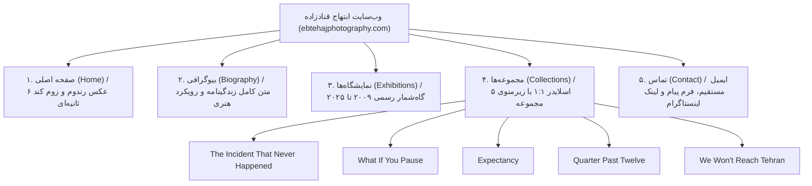

# ساختار معماری سایت و وایرفریم‌ها (Site Structure & Wireframes)

این سند، معماری اطلاعات، ساختار ۵ صفحۀ سایت و وایرفریم‌های متناظر با تصاویر ارائه‌شده توسط آقای ابتهاج قنادزاده را با جزئیات کامل شرح می‌دهد.

---

## ۱. نقشۀ صفحات وب‌سایت (Sitemap)

---

## ۲. ساختار هدر و سایدبار ثابت در تمام صفحات (Global Layout)

در تمام ۵ صفحۀ وب‌سایت، چیدمان ستون کناری و هدر یکپارچه و ثابت است:

### بالای صفحه (Header):
* **لوگوتایپ**: `EBTEHAJ GHANADZADEH` (حروف بزرگ لاتین، وزن بولد یا مدیوم، فاصله‌گذاری حروف مناسب)
* **بج عنوان**: کلمۀ `PHOTOGRAPHY` با حروف سفید در پس‌زمینۀ مستطیل مشکی توپر (Inverted Badge).

### ستون ناوبری چپ (Left Sidebar Navigation):
* `BIOGRAPHY`
* `EXHIBITIONS`
* `COLLECTIONS` (هنگام فعال بودن، ۵ زیرمجموعه در زیر آن با تورفتگی قرار می‌گیرند)
* `CONTACT`
* آیکون رسمی اینستاگرام (Instagram Glyph) با لینک به صفحۀ رسمی هنرمند.

**وضعیت‌های منو (Menu States):**
* **Active (صفحۀ جاری)**: رنگ مشکی تیره (`#000000`).
* **Inactive (سایر صفحات)**: رنگ خاکستری کم‌رنگ (`#999999` یا `#AAAAAA`).
* **Hover**: تغییر نرم خاکستری به مشکی با انیمیشن ملایم (Transition `200ms`).

---

## ۳. وایرفریم و مشخصات فنی ۵ صفحه (Wireframes)

### صفحۀ ۱: خانه (Home / Showcase) — تصویر ۴
* **محتوا**: یک باکس تصویر بزرگ مرکزی یا با موقعیت دقیق در مرکز-راست صفحه.
* **رفتار بصری**:
  - انتخاب یک عکس تصادفی (Random) از میان آثار مجموعه‌های نمایشگاهی.
  - اعمال افکت سینمایی **Ken Burns**: بزرگ‌نمایی بسیار ملایم و نرم (Slow Zoom In) در طول ۶ ثانیه برای هر عکس.
  - پس از ۶ ثانیه، محو شدن نرم (Fade Transition) و نمایش عکس تصادفی بعدی.

### صفحۀ ۲: بیوگرافی (Biography) — تصویر ۱
* **آیتم فعال منو**: `BIOGRAPHY` با رنگ مشکی و سایرین به رنگ خاکستری.
* **محتوا در بدنه**:
  - تیتر: `Artist / Filmmaker / Narrative Photographer`
  - پاراگراف ۱: معرفی رویکرد به فیلم‌های یک‌ثانیه‌ای و عکاسی استیجد/روایی.
  - پاراگراف ۲: مفهوم زبان سینما در عکاسی تک‌فریم.
  - پاراگراف ۳: آغاز مسیر از سال ۲۰۰۰ در دانشگاه هنر تهران و آغاز مجموعۀ «اتفاقی که هرگز نیفتاد» در ۲۰۰۶.
  - پاراگراف ۴: مجموعۀ «کافیست بایستی» در ۲۰۱۱ و نمایش در آرت بازل میامی.
  - پاراگراف ۵: دوره گذار و آثار ایزوله سال‌های پاندمی.
  - پاراگراف ۶: پروژه «دوازده و پانزده دقیقه» در ۲۰۱۸ بر پایه داستان کوتاه.
  - پاراگراف ۷: مجموعۀ «ما به تهران نمی‌رسیم» در ۲۰۲۲–۲۰۲۳ در گالری آران.
  - پاراگراف ۸: پروژه‌های جاری در مرز میان سینما و روایت‌گری.

### صفحۀ ۳: نمایشگاه‌ها (Exhibitions) — تصویر ۶
* **آیتم فعال منو**: `EXHIBITIONS` مشکی، بقیه خاکستری.
* **محتوا در بدنه**: فهرست تمیز و خطی از سال ۲۰۰۹ تا ۲۰۲۵ با تایپوگرافی تمیز و یکنواخت (بدون جدول خط‌دار، با فرمت ادیتوریال مینیمال).

### صفحۀ ۴: مجموعه‌ها (Collections) — تصاویر ۲ و ۳
* **آیتم فعال منو**: `COLLECTIONS` با زیرمنوی تورفته (Indented Submenu):
  - `THE INCIDENT THAT NEVER HAPPENED`
  - `WHAT IF YOU PAUSE`
  - `EXPECTANCY`
  - `QUARTER PAST TWELVE`
  - `WE WON'T REACH TEHRAN`
* **محتوای بصری**:
  - کادر عکس دقیقاً مربعی با نسبت **1:1** (`aspect-ratio: 1 / 1`).
  - کلیدهای جهت‌نما در چپ و راست کادر (`<` و `>`).
  - قابلیت سوایپ لمسی (Touch Swipe) در موبایل و تبلت و کلیدهای جهت‌نمای کیبورد.

### صفحۀ ۵: تماس (Contact) — تصویر ۵
* **آیتم فعال منو**: `CONTACT` مشکی، بقیه خاکستری.
* **محتوا در بدنه**:
  - ایمیل رسمی هنرمند: `info@ebtehajphotography.com` (با لینک `mailto:` فعال).
  - عنوان فیلد پیام: `messages:` (یا جعبه متن ارتباطی مینیمال).
  - کادر متنی ساده و بدون فریم اضافی (Minimalist Textarea) برای ارسال پیام مستقیم.
  - آیکون یا دکمه ارسال با سبک مینیمال.
